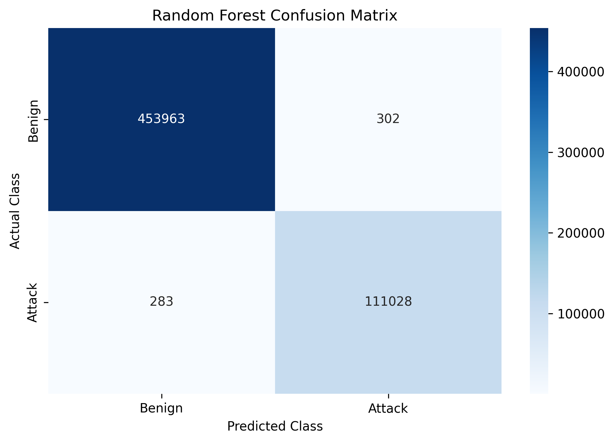

# Network Intrusion Detection System Using Machine Learning

A machine learning-based Intrusion Detection System (IDS) that classifies network traffic as benign or malicious using a Random Forest classifier trained on the CICIDS2017 dataset.

The project includes data preprocessing, leakage-aware feature selection, model training, evaluation using metrics suitable for an imbalanced dataset, and a command-line prediction script.

## Overview

The system follows these steps:

1. Load and clean the network traffic dataset.
2. Create a binary target label.
3. Split the dataset into training and testing sets.
4. Remove constant and highly correlated features using the training set only.
5. Train a Random Forest classifier.
6. Evaluate the model using multiple classification metrics.
7. Save the trained model for prediction.

### Classification Labels

- `0` — Benign traffic
- `1` — Attack traffic

## Key Features

- Binary network traffic classification
- Training-only correlation-based feature selection
- Stratified train-test split
- Random Forest classification
- Evaluation for imbalanced classification
- Confusion matrix visualization
- Command-line prediction using the saved model

## Dataset

**Dataset:** CICIDS2017

The dataset contains benign and malicious network traffic.

The cleaned dataset used by the notebook is:

`final_work.csv`

This file is generated during preprocessing and is excluded from Git because datasets can be large.

**Target column:** `Binary_Label`

- `0` represents benign traffic.
- `1` represents attack traffic.

The original dataset files are not included in this repository. Obtain the CICIDS2017 dataset from its official source and follow the notebook's data-loading requirements.

## Tech Stack

- Python
- Pandas
- NumPy
- Scikit-learn
- Matplotlib
- Seaborn
- Joblib
- Jupyter Notebook

## Project Structure

```text
Network_Intrusion_Detection_System_ML/
├── network_intrusion_detection.ipynb
├── predict.py
├── rf_model.pkl
├── confusion_matrix.png
├── requirements.txt
├── README.md
├── LICENSE
└── .gitignore
```

`final_work.csv` is generated locally and is not committed to the repository.

## Installation

### 1. Clone the repository

```bash
git clone https://github.com/FariyaRafat/Network_Intrusion_Detection_System_ML.git
cd Network_Intrusion_Detection_System_ML
```

### 2. Create a virtual environment (recommended)

Windows:

```bash
python -m venv .venv
.venv\Scripts\activate
```

Linux/macOS:

```bash
python3 -m venv .venv
source .venv/bin/activate
```

### 3. Install dependencies

```bash
pip install -r requirements.txt
```

If Jupyter Notebook is not installed:

```bash
pip install notebook
```

## Train the Model

1. Open the project in VS Code or Jupyter Notebook.
2. Open `network_intrusion_detection.ipynb`.
3. Ensure the CICIDS2017 source data is available at the paths expected by the notebook.
4. Run the notebook cells in order.

The notebook preprocesses the data, creates the train-test split, selects features using training data only, trains the Random Forest classifier, and evaluates the results.

The trained model is saved as:

`rf_model.pkl`

The cleaned intermediate dataset is saved as:

`final_work.csv`

## Feature Selection and Data Leakage Prevention

The notebook splits the dataset before performing correlation-based feature selection.

The feature-selection procedure:

1. Splits the data into training and testing sets using stratification.
2. Identifies constant features using the training set.
3. Calculates feature correlations using the training set only.
4. Removes highly correlated features using a correlation threshold of `0.90`.
5. Applies the same selected feature columns to both training and testing sets.

This prevents the test-set feature correlations from influencing feature selection.

The evaluation uses a stratified random split. Duplicate-flow overlap and generalization to independent capture days require separate validation.

## Model

**Algorithm:** Random Forest Classifier

Configuration:

- `n_estimators = 100`
- `random_state = 42`
- `n_jobs = -1`

The model is trained on the original class distribution. No oversampling, undersampling, or class weighting is applied in this experiment.

## Model Evaluation

The model is evaluated using:

- Accuracy
- Balanced accuracy
- Precision
- Recall
- F1-score
- Macro-F1
- Average Precision (AP)
- Confusion matrix
- False positive rate

### Reported Results

The following results are from the current notebook run:

| Metric | Score |
|---|---:|
| Accuracy | 99.90% |
| Balanced Accuracy | 99.84% |
| Macro-F1 | 99.84% |
| Attack Precision | 99.73% |
| Attack Recall | 99.75% |
| Attack F1-score | 99.74% |
| Average Precision (AP) | 99.83% |
| False Positive Rate | 0.07% |

These values are rounded from the notebook output. Performance is measured on a stratified random test split and should not be interpreted as a guarantee of performance on independent network traffic.

### Confusion Matrix



The confusion matrix compares actual and predicted classes:

- True Negative (TN): benign traffic correctly classified as benign.
- False Positive (FP): benign traffic incorrectly classified as an attack.
- False Negative (FN): attack traffic incorrectly classified as benign.
- True Positive (TP): attack traffic correctly classified as an attack.

## Run Prediction

After training the model and generating `rf_model.pkl`, run:

```bash
python predict.py
```

The script displays the feature names and their expected order. Enter the numeric values for all features in that order.

**Important:** Input values must correspond to the same feature definitions, units, and preprocessing used during training. Arbitrary numeric values are not a reliable substitute for actual network flow measurements.

## Limitations and Future Improvements

- Validate the model on independent capture days or traffic sources.
- Investigate duplicate and near-duplicate flows across train and test sets.
- Evaluate performance across individual attack categories.
- Compare models and decision thresholds based on attack detection and false alarm requirements.
- Integrate live network flow collection for real-time intrusion detection.

## License

This project is licensed under the Apache License 2.0. See the `LICENSE` file for details.

## Author

**Fariya Rafat**

GitHub: [FariyaRafat](https://github.com/FariyaRafat)
